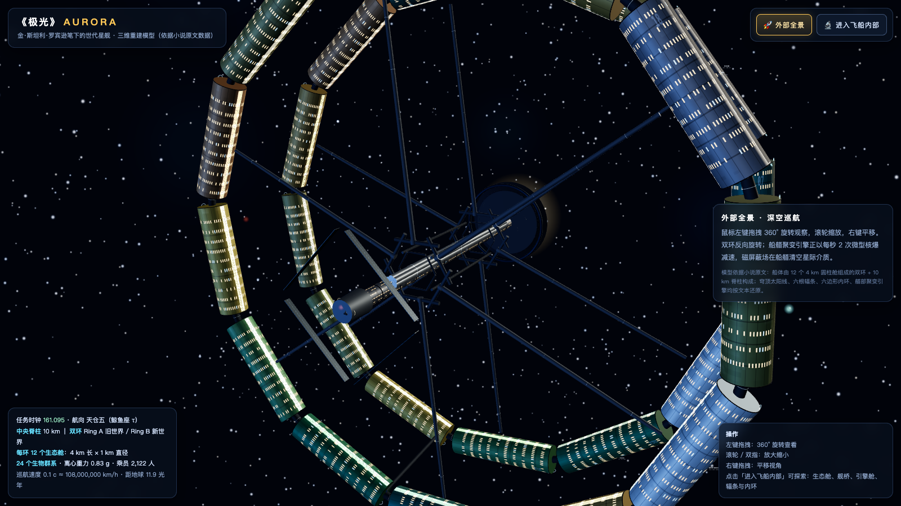
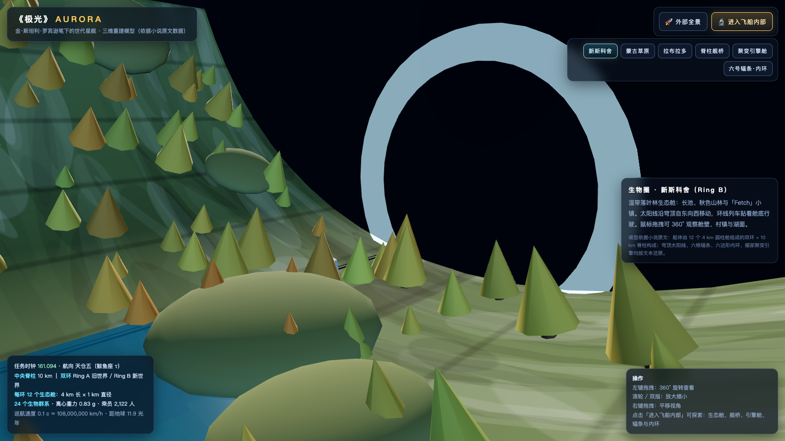

# 《极光》AURORA · 星际方舟三维模型

基于金·斯坦利·罗宾逊（Kim Stanley Robinson）科幻小说《极光》（*Aurora*, 2015，中译本《极光》）原文数据重建的「世代星舰」交互式三维模型。使用 **Three.js（本地 vendored，无 CDN 依赖）** 实现，可直接在浏览器中运行。





## 一、运行方式

1. 进入项目目录：
   ```bash
   cd aurora-starship
   ```
2. 启动任意静态文件服务器（ES Module 需要 http(s)，直接双击 index.html 会被浏览器拦截）：
   ```bash
   ./run.sh 8080
   # 等价于：python3 -m http.server 8080
   # 或：npx serve .
   ```
3. 打开浏览器访问：
   ```
   http://localhost:8080/
   ```
   Chrome / Edge / Safari / Firefox 最新版均可。建议使用桌面浏览器获得最佳体验。

> `vendor/` 内已内置 three.js r160 与 OrbitControls，完全离线可用；网络仅用于获取本 README 之外无任何运行时依赖。

## 二、操作说明

| 操作 | 功能 |
| --- | --- |
| 鼠标左键拖拽 | 360° 旋转查看飞船 / 舱室 |
| 滚轮 / 触控板双指 | 放大、缩小 |
| 鼠标右键拖拽 | 平移视角 |
| 「🚀 外部全景」 | 深空外景：双环反向旋转、星流、船艏核爆减速 |
| 「🔬 进入飞船内部」 | 切换到内部探索模式 |
| 内部导航按钮 | 新斯科舍 / 蒙古草原 / 拉布拉多 / 脊柱舰桥 / 聚变引擎舱 / 六号辐条·内环 |

## 三、必要的测试说明（验收清单）

按以下步骤手动回归：

1. **加载**：打开页面后加载动画消失，深空背景出现星点、星云与正前方天仓五（τ Ceti），页面无红色控制台报错。
2. **360° 观察**：在飞船外景按住左键拖拽，飞船可被从任意角度观察；鼠标滚轮能连续放大缩小，右键可平移。
3. **动态效果**：
   - 两座生态舱环 **反向旋转**（Ring A 顺时针 / Ring B 逆时针）；
   - 船艏聚变引擎 **每 0.5 秒（每秒 2 次）** 闪光一次，与小说「twenty years of fusion bombs going off twice a second」一致；
   - 红色/青色航行灯闪烁，星空相对飞船缓慢向后漂移。
4. **内部切换**：点击「进入飞船内部」，出现 6 个舱室按钮；逐个点击应看到：
   - 新斯科舍：湖泊、秋色山林、小镇、行驶中的环线列车；
   - 蒙古草原：金色草场与蒙古包聚落；
   - 拉布拉多：冰川、冰封盐湖与彩色房屋；
   - 脊柱舰桥：旋转的全息天仓五系统与 AI 核心；
   - 聚变引擎舱：脉冲反应堆、每秒 2 发的燃料微丸与旋转涡轮；
   - 六号辐条：螺旋楼梯、星光舷窗与六边形内环室。
5. **内部视角**：每个舱室均可左键 360° 旋转、滚轮缩放、右键平移；各舱室有独立文字说明。
6. **返回**：随时点击「外部全景」返回深空外景，飞船仍持续航行并保持动态。
7. **移动端（可选）**：单指旋转、双指缩放；顶部模式按钮可正常切换。

自动化烟雾测试示例（可选，使用 Chrome DevTools 或 Playwright）：
```js
// 页面加载完成后：
window.__AURORA.mode;            // 'exterior'
window.__AURORA.setMode('interior');
window.__AURORA.showLocation('engine');
window.__AURORA.activeLoc;       // 'engine'
```

## 四、模型还原依据（关键数据）

模型不是自由想象，而是按小说原文（Chapter 2 / Ship 的自述）逐项建立：

| 小说原文数据 | 模型实现 |
| --- | --- |
| “The ship is made of two rings or toruses attached by spokes to a central spine.” | 双环 + 六辐条 + 中央脊柱 |
| “The spine is ten kilometers long.” | 脊柱长度 10,000 m（1 单位 = 1 m） |
| “Each torus is made of twelve cylinders. Each cylinder is four kilometers long…” | 每环 12 个舱体，每个 4,000 m |
| “The biome cylinders are a kilometer in diameter…” | 舱体直径 1,000 m |
| “Ring B was only fifty-four kilometers around…” | 环中心半径约 8,400 m，12 舱 + 舱间联锁形成 54 km 环线 |
| “There is a sunline running along the length of the ceiling of each biome.” | 每舱内侧面发光太阳线 + 穹顶日灯（内部可见） |
| “Ceilings … nearest the spine … floors … on that side [away from spine].” | 舱体朝向：地板朝外、穹顶朝脊柱 |
| “The rotation of the ship around its spinal axis creates a .83 g equivalent…” | 双环以 0.83 g 对应的视觉效果反向旋转 |
| “The deceleration is being accomplished by the frequent rapid fusion explosion of small pellets of deuterium/helium 3 fuel in a rocket engine at the bow…” | 船艏惯性约束聚变引擎，每秒 2 次闪光减速 |
| “The inner ring is a hexagon. There are six spokes…” | 六边形内环 + 六根辐条 |
| “Ring A consists of twelve Old World ecosystems… Ring B twelve New World…” | Ring A：塔斯马尼亚、喜马拉雅、扬子、西伯利亚、伊朗、蒙古、大草原、巴尔干、肯尼亚、孟加拉、印度尼西亚、极地冰川；Ring B：新斯科舍、谢拉、北美草原、拉布拉多、潘帕斯、索诺拉、皮埃蒙特、哥斯达黎加、亚马逊、奥林匹亚、巴塔哥尼亚、极地冰川 |
| “Two thousand, one hundred twenty-two people…” / “0.1 c … 30,000 km/s … Tau Ceti, 11.9 light-years…” | HUD 任务时钟与航行参数 |

更多原文引文见 [`docs/小说还原说明.md`](docs/小说还原说明.md)。

## 五、目录结构

```
aurora-starship/
├── index.html              # 页面与 UI
├── run.sh                  # 一键启动脚本
├── test-smoke.sh           # 静态依赖冒烟测试
├── js/
│   └── main.js             # 场景、飞船、内部舱室、动画、交互
├── vendor/
│   ├── three.module.js     # Three.js r160（本地）
│   └── OrbitControls.js    # 轨道控制器（本地）
├── docs/
│   ├── 小说还原说明.md
│   ├── preview-exterior.png
│   └── preview-interior.png
└── README.md
```

## 六、说明

- 小说中未给出全部 24 个舱体名称，Ring A / Ring B 各有一个「极地冰川」舱在文本中没有出现具体地名，模型按生态带名称标注，未杜撰地名。
- 舱体蒙皮颜色按 12 个气候带生成，并非小说给定颜色；小说未指定的机械细节（舱外窗列、散热鳍等）为符合 0.1c 深空航行常识的补全。
